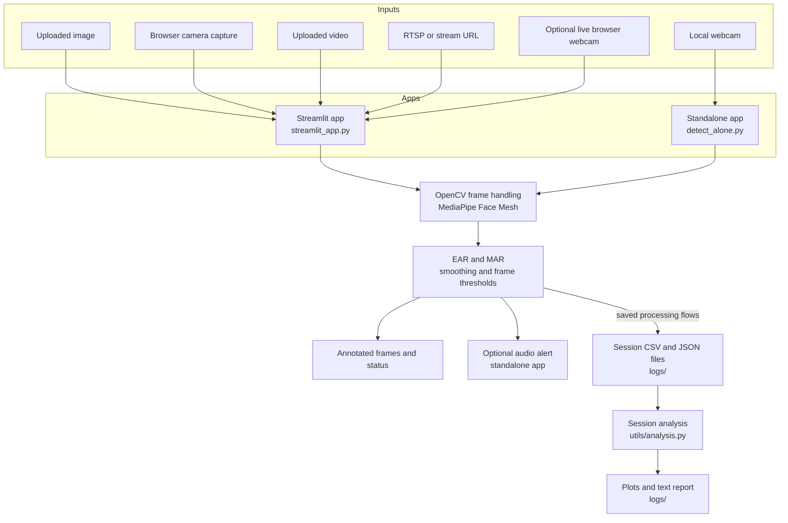

# Drowsiness Detection

A Python computer-vision project that estimates eye and mouth movement from facial landmarks to flag possible drowsiness and yawning. It includes a Streamlit interface for image, video, camera, and stream inputs, a standalone OpenCV webcam application, and tools for reviewing saved session data.

## Features

- Detects facial landmarks with MediaPipe Face Mesh and calculates Eye Aspect Ratio (EAR) and Mouth Aspect Ratio (MAR).
- Uses recent metric values and consecutive-frame thresholds to reduce reactions to brief changes.
- Displays processed frames and detection status; the standalone application can also play an audio alert when audio is available.
- Accepts uploaded images and videos, a single browser-camera capture, an RTSP/stream URL, and (when `streamlit-webrtc` is installed) a live browser webcam.
- Saves session summaries as JSON and per-frame measurements as CSV for supported processing flows.
- Includes an analysis utility for session summaries, detailed CSV sessions, plots, and a text report.

## Architecture and data flow



The Streamlit app is the primary multi-input interface. Its optional live WebRTC mode streams processed frames to the browser; session-file saving is performed by the image, video, and RTSP processing flows. The standalone app reads from a local webcam and saves session data when requested or when it exits. Processing uses OpenCV and MediaPipe in the running Python application; the live WebRTC mode is configured with a STUN server.

## Requirements

- Python 3.11 is specified in `runtime.txt`; use that version for the environment described here.
- A webcam is needed for the standalone app, browser-camera capture, or live webcam mode.
- Speakers are optional; audio alerts depend on the local audio system.
- On Linux environments, `packages.txt` lists the system packages used by the deployment environment.

Python dependencies are pinned in `requirements.txt`. `streamlit-webrtc` is included there; the app also handles it as an optional import and hides the live webcam mode if it is unavailable.

## Installation

Run these commands from the repository root:

```text
python -m venv .venv
```

Activate the environment:

```powershell
# Windows PowerShell
.venv\Scripts\Activate.ps1
```

```sh
# macOS or Linux
source .venv/bin/activate
```

Then install the dependencies:

```text
python -m pip install --upgrade pip
python -m pip install -r requirements.txt
```

## Run

### Streamlit interface

```text
streamlit run streamlit_app.py
```

Choose an input mode in the sidebar:

- **Image** — upload a PNG, JPG, or JPEG image.
- **Camera (single shot)** — capture and process one image from the browser camera.
- **Video** — upload an MP4, MOV, AVI, or MKV file; optionally set a frame limit or process every Nth frame.
- **RTSP Stream** — provide a stream URL and capture duration.
- **Live Camera (webcam)** — process browser webcam frames in real time; available when `streamlit-webrtc` is installed.

The image, video, and RTSP flows offer downloads of their processed media and save session data under `logs/`. The live webcam mode displays processed frames but does not save session files.

### Standalone webcam application

```text
python detect_alone.py
```

The application opens the default local camera. Use `q` to quit, `s` to save the current session, or `r` to reset the session totals and recorded data. On shutdown it releases the camera and saves a final session.

### Alternate webcam-focused Streamlit application

`detect_offline.py` contains a separate Streamlit application that reads from the local webcam:

```text
streamlit run detect_offline.py
```

## Detection and configuration

For each detected face, the detector selects eye and mouth landmarks, calculates EAR and MAR, and averages recent measurements. Drowsiness is flagged when the smoothed EAR remains below its threshold for the configured number of consecutive frames; yawning is flagged when smoothed MAR remains above its threshold for the configured number of frames.

The detector defaults are EAR `0.3`, MAR `0.6`, 15 consecutive frames for drowsiness, and 10 for yawning. In `streamlit_app.py`, the EAR, MAR, and frame-count thresholds can be adjusted with the sidebar sliders. The standalone app uses the detector defaults.

## Session data and analysis

Session files are written to `logs/`:

- CSV files contain timestamped EAR/MAR values and drowsiness/yawn status for processed frames.
- JSON files contain a session summary, including duration, event counts, and thresholds.

Run the interactive analysis utility from the repository root:

```text
python utils/analysis.py
```

It reads session files from `logs/` and can create summary or detailed plots and a comprehensive text report there. Generate useful analysis by running a detection session and saving data first.

## Repository layout

```text
.
├── streamlit_app.py       # Multi-input Streamlit interface
├── detect_alone.py        # Standalone OpenCV webcam application and detector
├── detect_offline.py      # Alternate webcam-focused Streamlit application
├── config.py              # Configuration helper
├── setup.py               # Dependency/device setup and checks
├── requirements.txt       # Pinned Python dependencies
├── packages.txt           # Linux system packages
├── runtime.txt            # Python runtime version
├── utils/
│   └── analysis.py        # Session analysis and report generation
└── logs/                  # Session CSV/JSON files and generated reports
```

## Limitations

Detection depends on visible facial landmarks, camera placement, and lighting, and can produce incorrect results. Treat alerts as an aid rather than a substitute for rest or safe operating practices.
